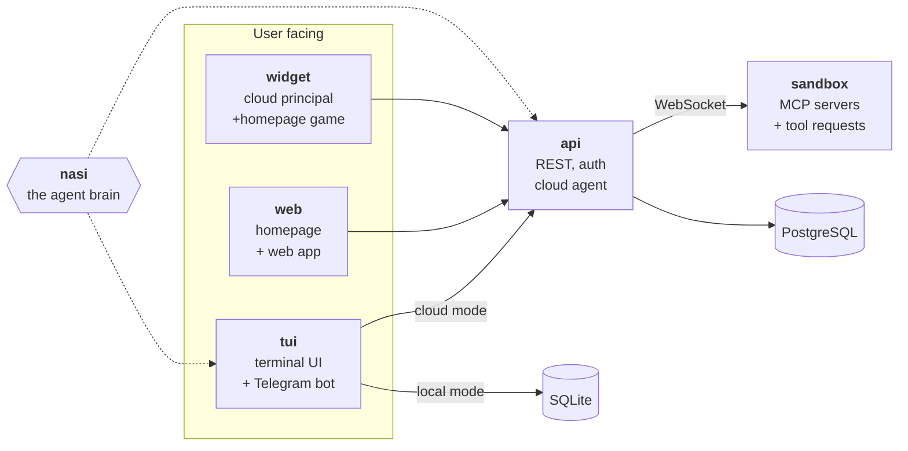

# 가자⛲


[](https://sonarcloud.io/summary/new_code?id=SubZtep_kaja)

> [!IMPORTANT]
> Kaja is still evolving :speaker::godmode::loudspeaker:

Kaja is an agentic AI harness. Give it a task and it keeps looping with an LLM, using tools — on the user’s machine or in an isolated sandbox environment — and switching personas as needed, until the job is done.

Point it at a local model or a cloud-based one, and chat with it in a terminal or on Telegram. A cloud widget can call the same models for a program you publish, such as the homepage game.

The terminal client runs on macOS and Linux (x64 and arm64). The Windows build is experimental and untested; shell commands don't work there yet.

Under the hood it’s a full-stack playground: a **Hono API** secured by **Better Auth**, a **TanStack Start** web app, and a **React Ink** terminal agent.

## Repository map



`nasi` runs inside both the terminal (local mode) and the API (cloud), and `schema` and `shared` are used everywhere.

| Workspace                               | What it is                                                                                                        |
| --------------------------------------- | ----------------------------------------------------------------------------------------------------------------- |
| [`apps/api`](./apps/api/)               | Hono REST API: Better Auth, the cloud agent, emails, and widget tokens                                            |
| [`apps/web`](./apps/web/)               | TanStack Start: the public homepage and the signed-in web app                                                     |
| [`apps/tui`](./apps/tui/)               | Ink terminal UI and Telegram bot, with local config and storage                                                   |
| [`apps/sandbox`](./apps/sandbox/)       | Runs stdio MCP servers (headless Chrome and more) and sends tool requests out for cloud turns; anyone can run one |
| [`packages/nasi`](./packages/nasi/)     | The agent brain: the loop, tools, personas, memory                                                                |
| [`packages/schema`](./packages/schema/) | Every Zod schema and type, in role-based subpaths                                                                 |
| [`packages/shared`](./packages/shared/) | Small pure utilities, including the Telegram plumbing both bots share                                             |

## Required packages

Install some OS-level dev tools directly on your machine instead of adding them as npm dependencies. This gives better performance and keeps the repository lighter.

### Essentials

Needed just to run Kaja from source, as shown in the [next section](#run-from-the-source):

- [Bun](https://bun.com/docs/installation#canary-builds) (canary)
- [Docker Compose](https://docs.docker.com/compose/install/)
- [Git](https://git-scm.com/install/)
- [RustFS CLI](https://docs.rustfs.com/en/operations/rc) ― (`rc`; AUR: `rustfs-cli-bin`) S3 compatible

### For development

On top of the essentials above, if you plan to contribute code:

- [Lefthook](https://lefthook.dev/install/) ― Git hooks, run `lefthook install` once after cloning
- [Tombi](https://tombi-toml.github.io/tombi/docs/installation) ― TOML formatter and linter

### Optional

Only needed if you use the matching feature:

- Chromium — for `bun dev:sandbox` (skip it if you run the sandbox through Docker Compose instead)
- A Secret Service keyring, such as gnome-keyring on Linux — the terminal UI stores its login with `Bun.secrets`, and the tests need it too
- [Claude Code](https://claude.com/claude-code) — the pre-push hook uses it to translate new locale keys
- Ruby with Bundler — for `bun dev:docs`, the Jekyll docs site

## Run from the source

Run the commands below in sequence:

```bash
# Get the source
git clone https://github.com/SubZtep/kaja.git
cd kaja

# Install dependencies
bun i

# Prepare local Docker volume folders (uses sudo for ownership fixes)
scripts/prepare_data_dirs.sh

# Start all the services
docker compose up -d

# Create the storage bucket
scripts/storage_init.sh

# Configure local API endpoint
cp apps/tui/.env.example apps/tui/.env

# Run the terminal UI
bun dev:tui
```

The first run starts a short setup wizard: sign in to Kaja Cloud, or point it at your own LLM provider(s) and it writes `~/.config/kaja/` for you.

### Composed web service frontends

| Address                         | Notes                                             |
| ------------------------------- | ------------------------------------------------- |
| http://localhost:3000           | Website and portal                                |
| http://localhost:3001/reference | API documentation                                 |
| http://localhost:1080           | Email inbox                                       |
| http://localhost:9001           | Storage browser. Login: `kaja`:`kaja-dev-storage` |

## Documentation

Want more? 🐓 Visit [docs.kaja.io](https://docs.kaja.io/).
