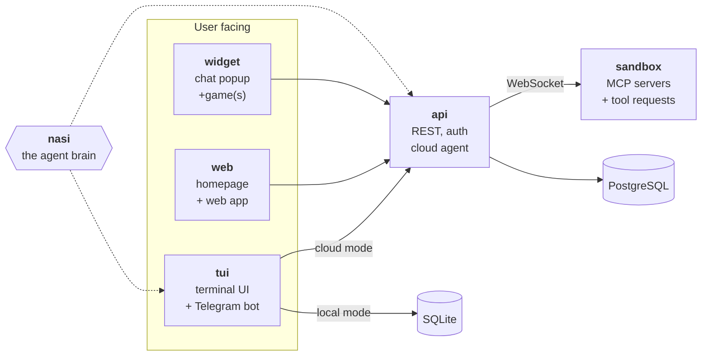

# 가자⛲


[](https://sonarcloud.io/summary/new_code?id=SubZtep_kaja)

> [!IMPORTANT]
> Kaja is still evolving :speaker::godmode::loudspeaker:

Kaja is an agentic AI harness. Give it a task and it keeps looping with an LLM, using tools — on the user’s machine or in an isolated sandbox environment — and switching personas as needed, until the job is done.

Point it at a local model or a cloud-based one, chat with it in a terminal, on Telegram, or through a widget on your own website.

Under the hood it’s a full-stack playground: a **Hono API** secured by **Better Auth**, a **TanStack Start** web app, and a **React Ink** terminal agent.

## Repository map



`nasi` runs inside both the terminal (local mode) and the API (cloud), and `schema` and `shared` are used everywhere.

| Workspace                               | What it is                                                                                                        |
| --------------------------------------- | ----------------------------------------------------------------------------------------------------------------- |
| [`apps/api`](./apps/api/)               | Hono REST API: Better Auth, the cloud agent, emails, and serves the [widget](./apps/api/widgets/) bundle          |
| [`apps/web`](./apps/web/)               | TanStack Start: the public homepage and the signed-in web app                                                     |
| [`apps/tui`](./apps/tui/)               | Ink terminal UI and Telegram bot, with local config and storage                                                   |
| [`apps/sandbox`](./apps/sandbox/)       | Runs stdio MCP servers (headless Chrome and more) and sends tool requests out for cloud turns; anyone can run one |
| [`packages/nasi`](./packages/nasi/)     | The agent brain: the loop, tools, personas, memory                                                                |
| [`packages/schema`](./packages/schema/) | Every Zod schema and type, in role-based subpaths                                                                 |
| [`packages/shared`](./packages/shared/) | Small pure utilities, including the Telegram plumbing both bots share                                             |

## Run from the source

Make sure [Bun](https://bun.com/docs/installation), [Docker Compose](https://docs.docker.com/compose/install/), and [Git](https://git-scm.com/install/) are installed. Run the commands below in sequence.

```bash
# Get the source
git clone https://github.com/SubZtep/kaja.git
cd kaja

# Install dependencies
bun i

# Start all the services
docker compose up -d

# Configure local API endpoint
cp apps/tui/.env.example apps/tui/.env

# Run the terminal UI
bun dev:tui
```

The first run starts a short setup wizard: sign in to Kaja Cloud, or point it at your own LLM provider(s) and it writes `~/.config/kaja/` for you.

## Development

Besides Bun, Docker Compose and Git from above, install these on your machine; none of them is an npm dependency:
- [Biome](https://biomejs.dev/guides/manual-installation/): linter and formatter
- [Tombi](https://tombi-toml.github.io/tombi/docs/installation): TOML formatter and linter
- [Lefthook](https://lefthook.dev/installation/): runs the Git hooks, so run `lefthook install` once after cloning

`bun lint` warns when the installed Biome or Tombi differs from the version pinned in [`scripts/lib/tools.ts`](./scripts/lib/tools.ts) (Biome's comes from the `$schema` URL in `.biome.json`).

Optional, for parts of the repo:
- Chromium: `bun dev:sandbox`, unless you run the sandbox through Docker Compose
- A Secret Service keyring such as gnome-keyring (Linux): the terminal UI stores its login with `Bun.secrets`, and the tests need it too
- [Claude Code](https://claude.com/claude-code): the pre-push hook uses it to translate new locale keys
- Ruby with Bundler: `bun dev:docs`, the Jekyll docs site

## Documentation

Want more? 🐓 Visit [docs.kaja.io](https://docs.kaja.io/).
