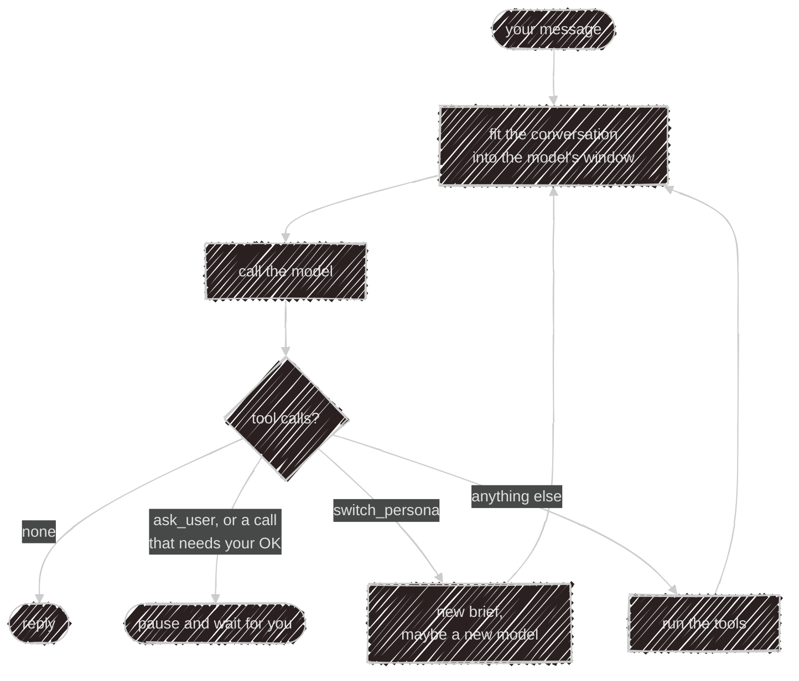

# Inside Nasi

The [Nasi](/abilities/nasi) page says what the agent does. This one opens the lid: how a turn actually runs,
where it stops to ask you, and the small tricks that keep it from falling over. No code needed to follow it.

## One brain, carried around

Nasi isn't a service you connect to. It's a library, and whatever hosts it runs it in-process: the terminal
in local mode, and the Kaja API for cloud chat, the cloud Telegram bot and the widget. Each host hands it the
same four things: a model, a place to store conversations, a set of tools, and a few words about where it's
running. Nasi reads no config file and opens no database of its own.

The terminal in cloud mode is the odd one out: it runs no loop at all. It carries a small HTTP client and
lets the API think, which keeps it light.

In the cloud one store holds many people's conversations, so every conversation has an owner: your account,
a Telegram user, or one widget visitor. Ask to resume a conversation that isn't yours and it simply isn't
there. That's what keeps two visitors of the same website widget out of each other's chats.

## A turn is a series of rounds

When you send a message, Nasi runs **rounds**: call the model, run the tools it asked for, feed the results
back, call the model again. The turn ends with the first round that asks for no tools. That's the reply.

Every round starts by checking the conversation still fits the model's window, because each round adds tool
results to it. More on that [below](#fitting-a-long-chat-into-a-small-window).

## Three tools that aren't really tools

Most tools just run. Three are caught by the loop instead, because their whole job is to hand control back:

- **`ask_user`** stops the turn. The conversation remembers the open question, and your next message becomes
  its answer.
- **`run_command`** runs a shell command at once only when it's plainly harmless: it matches your
  [safe list](/config/settings#commandstoml-commands-that-run-without-asking), has no shell tricks (no
  `;`, `&&`, pipes, redirects or `$(…)`), nothing on the risky list (`rm -rf`, `sudo`, a force push) and doesn't touch a
  credentials file. Anything else waits for your OK.
- **`switch_persona`** rewrites the brief in place, the system prompt the conversation started with, and may
  swap the model mid-turn. The new persona carries on from where the old one stopped.

An HTTP tool or MCP call that changes something waits for your OK the same way. Only one thing can wait at a
time, so if the model asks for two approvals in one round, the second is told another step is waiting and to
try again afterwards. Every call the model makes always gets an answer of some kind, which models need to
keep their bearings.

## Small kindnesses

Models misbehave in small ways, and Nasi quietly covers for them:

- **A reply ending in `?` counts as a question.** It's treated like `ask_user`, so a cloud turn pauses for
  your answer instead of finishing.
- **An empty round is nudged.** A round with no text and no tool call is retried up to five times. If the
  model still has nothing, you get "I'm drawing a blank on that one", never a blank bubble.
- **Leaked tags are wiped.** Some models write their tool calls as text and leave closing tags like
  `</invoke>` at the end of a reply. Those are stripped.
- **Failure has a limit.** A failed tool doesn't end the turn: the model sees the error and can try another
  way. After three rounds in a row where every tool call failed, Nasi stops.

## Fitting a long chat into a small window

A model reads only so much at once, its **context window**. A long conversation with big tool results soon
outgrows it, so before every round Nasi decides what the model gets to see. What it stores never shrinks:
the conversation log keeps every message, every full tool result and every image.

**How big is the window?** The host may know (the cloud has it per model), or your
[`models.toml`](/config/models) says so. Otherwise Nasi asks the model's server (llama.cpp, Ollama,
OpenAI-compatible and Fireworks APIs, all at once) and remembers the answer, falling back to 32,768 tokens.
If a provider still says the prompt is too long, Nasi lowers its idea of the window, compacts, and tries the
round once more.

**How full is it?** Counting tokens exactly would need each model's tokenizer, so Nasi estimates from the
length of the text (about four characters to a token) and corrects the estimate every round with the count
the provider sends back.

Then, in order:

1. **Huge tool results are condensed.** One result over a quarter of the window (a long web page, a big
   file) is summarised once, with the summariser told which call produced it and what you asked, so it keeps
   what matters. The model sees the short version from then on.
2. **Old images lose their pixels.** Images from before your last two messages are sent as a one-line label.
   The model already looked at them, and resending the bytes every round is expensive. `view_image` brings
   one back when it's needed.
3. **The conversation is compacted.** Past 80% of the window, everything except a recent tail is summarised.
   The tail fits a quarter of the window and starts at one of your messages where it can, never at a tool
   result, since a result without the call that asked for it would confuse the model. The summary joins the
   brief, and the model reads it followed by the tail. If the summary can't be written, the older part is
   dropped with a note saying so, and the turn goes on.

The summaries are written by the model with the `summarize` task, when you have one, else the chat model
itself. Text too big even for it is summarised in parts, and then the parts together. `/compact` does the
same on demand, and can be told what to keep: `/compact keep the dates`.

## How it sees images

An image is stored the moment it arrives, turned the right way up, stripped of its metadata (GPS included)
and fitted inside 1,568 pixels a side, the most Claude takes without shrinking it again. The message carries
a label instead of the file: `[Image kaja-image:<id> (1280×720): a cat on a sofa]`. The label starts with whatever
alt text the image came with. Meanwhile a vision model writes a short description in the background, which
replaces it.

That label is how a model that can't see still follows along: it gets the labels and no pixels, and its
round waits until the descriptions are in. A model that can see gets both.

## A cloud turn can borrow your computer

When you chat in cloud mode from the terminal, the thinking happens on the API, but your terminal can lend
it tools that only exist on your machine: your files, your shell, your own abilities. With each message the
terminal says what it can run. The API's loop treats those tools as stand-ins: when the model calls one, the
turn pauses, your terminal runs it (asking you first wherever local mode would), and sends the results back.
The loop then carries on without you typing anything.

An ability your terminal offers hides the cloud's copy of it for that turn, so one ability never runs in two
places at once. [Cloud or local](/start/modes#your-computer-in-cloud-mode) has the user's side of
this.

## Careful by default

A few rules keep the cloud from doing anything by accident:

- **New tools stay home.** The cloud gets an explicit list of built-in tools. A tool added to Nasi later isn't
  in the cloud until someone puts it there.
- **The server never fetches.** In the cloud, web requests (`fetch_url`, HTTP tools, remote MCP servers) go
  out through a [sandbox](/abilities/mcp#in-the-cloud), redirects included. With no sandbox to send them
  through, the tool is left out rather than fetching from the server.
- **Nasi never logs.** A skipped ability or a failed connection is reported to whoever hosts it, which
  decides where it goes: the API prints it, and the terminal writes it to its log file, since the screen
  belongs to the chat.

---

Next:

[Configuration](/config){: .btn .btn-green .fs-5 }
