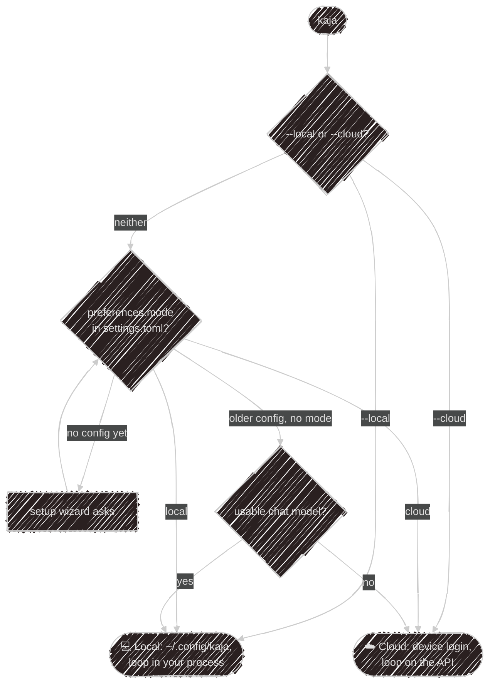

# Cloud or local

The two modes differ in _where the agent loop runs_, and so in which tools it can use.

| Front door                                    | Loop runs on | Store    | Your files, shell and own MCP servers                          |
| --------------------------------------------- | ------------ | -------- | -------------------------------------------------------------- |
| `kaja`, local mode                            | your machine | SQLite   | ✓                                                              |
| `kaja telegram`                               | your machine | SQLite   | ✓                                                              |
| `kaja`, cloud mode                            | the API      | Postgres | ✓ through the terminal ([below](#your-computer-in-cloud-mode)) |
| cloud [Telegram bot](/use/telegram#cloud-bot) | the API      | Postgres | ✗                                                              |
| Website [widget](/use/widget)                 | the API      | Postgres | ✗                                                              |

## Which mode a launch uses



The [setup wizard](/start/wizard) saves your choice as `preferences.mode`, even before a provider
works. A flag overrides it for one launch:

```sh
kaja --local     # local agent loop, even with no config yet
kaja --cloud     # cloud login, even if a local config exists
```

## Cloud mode

The first time, Kaja does a **device login**: it shows a code, you approve it at
[kaja.io/device](https://kaja.io/device), and a token goes into your OS keychain. Nothing is written to
disk. One account is signed in at a time: `kaja login` signs in without starting a chat, and `kaja logout`
clears it.

> Without a keychain, cloud mode stops and suggests `--local`. There is no plaintext fallback.
> {: .warning }

The server picks the model (there's no model switching) and keeps your sessions, memory and dataset
answers. The agent gets the cloud [built-in tools](/abilities/tools#built-ins) and every persona in the
marketplace, each with the abilities it lists ([Abilities in the cloud](/abilities/marketplace#in-the-cloud)).
Tools that reach the internet run on a [sandbox](/abilities/mcp#in-the-cloud), never on the API itself.

### Your computer in cloud mode

In the terminal, cloud chat can also use your own computer. The terminal runs those tools itself and sends
the cloud only their results:

- your own abilities (the ones in your marketplace folder that no sync wrote), and local-only ones like
  `filesystem`, with the folders your personas give them;
- any `stdio` [MCP ability](/abilities/mcp) you set to `computer` in
  [`[tools.hosts]`](/config/settings#toolshosts);
- `read_file`, `list_files` and `view_image`;
- your shell (`run_command`), only once you allow it with `shell = "computer"` in `[tools.hosts]`.

They ask first exactly as in local mode. Your own personas, and local-only ones like `config-hyprland`,
join the persona picker. Nothing of this is stored in the cloud beyond the conversation itself. The cloud
Telegram bot and the widget have no computer behind them, so they never get these tools.

## Local mode

The whole agent runs in your process:

- config comes from `~/.config/kaja/` ([Configuration](/config/files));
- models come from your `models.toml`. Without a chat model Kaja exits with an error; it never falls back
  to the cloud;
- every tool works: files, shell, MCP servers, hosts on your own network;
- sessions, memory and dataset answers live in a [SQLite file](/config/storage);
- `kaja -c` resumes the last session, `kaja -s <id>` a specific one, and `kaja sessions` lists them.

---

Next:

[Setup wizard](/start/wizard){: .btn .btn-green .fs-5 }
